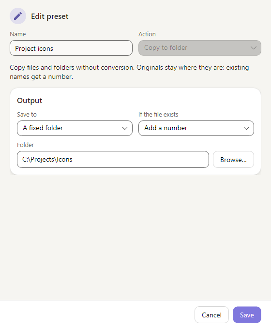
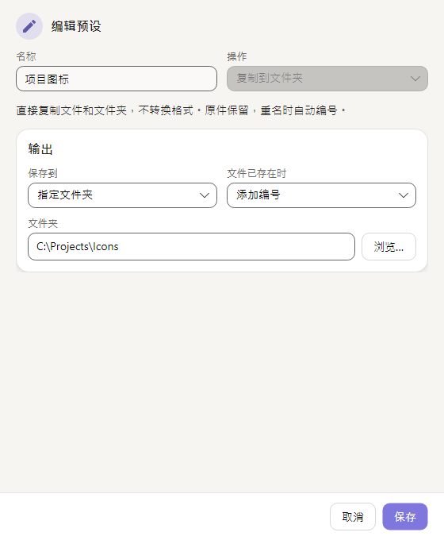
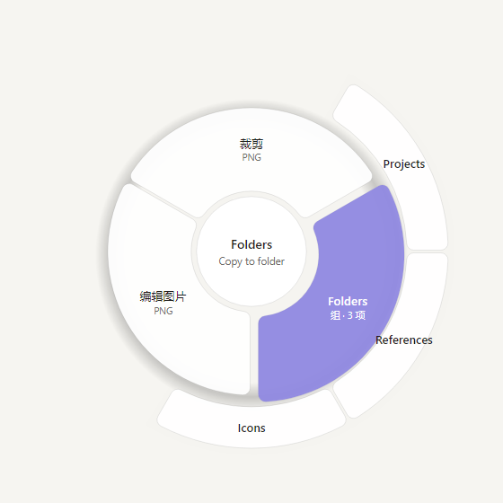

# Review evidence for #813 and #814

Base: upstream `7fc129f`. Platform: Windows x64, .NET SDK 10.0.102. The installed Filee and the personal browser extension were not changed.

## #813 — standalone SVG selections (`a63aa10`)

`dotnet format Filee.slnx --no-restore --verify-no-changes` passed.

| Test project | Passed | Failed in final run |
| --- | ---: | ---: |
| App | 1,638 | 0 |
| CLI | 55 | 0 |
| Core | 773 | 0 |
| Engines | 1,942 | 0 |
| Platform | 94 | 0 |
| Setup | 206 | 0 |

Final-head browser drop recheck: 18 passed, zero skipped. It drives Avalonia DragEnter/Drop with Ctrl through PNG and PDF, checks a red PNG pixel / drawn PDF path, rejects unrelated text, and asserts external references fail without leaving an output.

The initial solution-wide run found two environmental issues. Setup assumes default application paths, so its complete project was rerun without `FILEE_DATA_DIR`. One pre-existing StallWatch timing assertion failed during concurrent workload; a complete Engines rerun passed. These tests were not changed or excluded.

## #814 — Copy to folder (`099adb5`)

- `dotnet format Filee.slnx --no-restore --verify-no-changes`: passed.
- All six test projects passed: App 1,635; Cli 55; Core 758; Engines 1,942; Platform 94; Setup 206 (4,690 passed, zero failures in the final project runs).
- Regression group: 48 passed, zero skipped. It includes the real browser drop -> back-face folder slice -> byte comparison, cancellation before fetching/enqueueing, preset editor/groups and the existing shared-window tests.
- Core tests cover byte identity for a browser download, untouched local originals, numbered clashes, missing destination without creation, same-folder no-op, batches/folder structure, cancellation cleanup and watched-folder delivery.

The initial full run exposed an existing test cleanup bug: the random tray-click test retained simulated click flags and reopened the main window while cleaning up, causing five later tests to fail. A minimal combination reproduced it. Commit `099adb5` clears those flags only in the test's cleanup and asserts the window is gone; it does not change production window behavior. The complete App project was then rerun successfully with normal collection parallelism.

App/engine tests used isolated `FILEE_DATA_DIR`; Setup was rerun without that override because it asserts real default paths. Optional-engine/OS-specific/Explorer-package/symlink tests and the intentionally disabled upstream media-generation test remain skipped; none are counted as passed. Directory symlinks/reparse points fail explicitly rather than being followed during folder copying.

The pictures below come from actual Avalonia windows and DonutMenu controls in the headless UI tests, using the application's real styles and Skia renderer. They are not design mockups or a recording of native OS dialogs. Destination names and paths are examples.

| Preset editor | Back-face folder group |
| --- | --- |
|  |  |
|  |  |

## Reproduction and limits

Start with `dotnet test Filee.slnx -p:NuGetAudit=false -p:UseSharedCompilation=false -m:1 -nr:false`.

On this machine, App/engine tests need an isolated `FILEE_DATA_DIR`: otherwise the existing engine installation test cannot find two not-yet-installed engines. Setup tests instead require the normal default paths, so unset that environment variable when running `dotnet test tests/Filee.Setup.Tests --no-build --no-restore`.

Conditional tests for unavailable optional engines, OS-specific APIs, missing Explorer packaging artifacts and symlink permissions remain skipped, as does the intentionally disabled upstream media-generation test. They are not counted as passing tests. Upstream CI is still required for its own platform/environment coverage.
